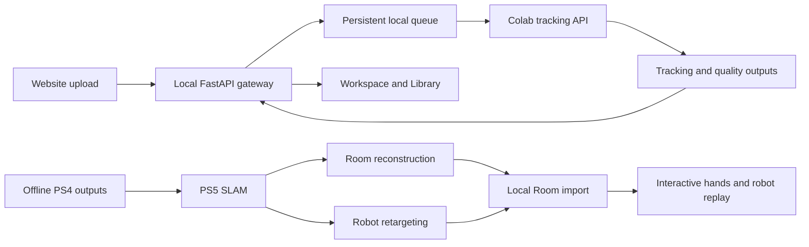

# SpectatorAI technical reference

This guide describes the checked-in system. [README.md](README.md) covers installation and everyday use.

## Repository map

| Location | Responsibility |
|---|---|
| `code/ps4v4/` | Tracking, source labels, quality assessment, rendering and exports |
| `code/server/` | Authenticated Colab job API and transfer activity tracking |
| `code/tools/colab_start.py`, `colab_session.py`, `idle_guard.py` | Cached installation, model startup, tunnel, discovery and idle shutdown |
| `code/ps5world/` | SLAM integration, room-frame trajectories and world rendering |
| `code/room/` | Depth-assisted workstation reconstruction, room rendering and web export |
| `code/robot/` | Franka Panda retargeting, robot assets and copyability grades |
| `dashboard/backend/` | Local gateway, queue, media preparation, Library, Dataset and Room routes |
| `dashboard/frontend/` | React 18, TypeScript, Vite 6 and Three.js website |
| `tools/` | Notebook/private bundle generation and synthetic room fixtures |
| `code/tests/`, `dashboard/tests/` | Pipeline, API, startup, room and browser checks |

## Data flow and runtime ownership



`run.bat` serves the website and API on localhost:8000. Node builds the frontend; it is not a second
production server. Vite's development server proxies `/api` to the local backend.
The remote notebook runs the tracking server and Cloudflare tunnel; the local gateway holds its credentials.
The browser receives local API URLs rather than the remote API key. Discovery uses an unguessable ntfy topic
and can optionally use a Drive URL file or manual origin override.

Only the dashboard tracking workflow is automatic on upload. PS5, room reconstruction and robot retargeting
are separate commands/notebooks. Their imported results replay locally without allocating a Colab GPU.

## Tracking pipeline

| Stage | Output or decision |
|---|---|
| M1 | Camera intrinsics and fisheye model; calibration/GeoCalib/fallback as configured |
| M2 | Candidate hand boxes, including configured low-light detection |
| M1H | Head rotation from background motion with hands masked |
| M3 | Candidate tracklets, split at crossings or handedness changes |
| M3P | Sampled 3D, reach/forearm evidence and CLIP verification |
| M3A | Track-level left/right/reject assignment |
| M4 | 3D reconstruction from distortion-corrected crops |
| M5 | Outlier removal, smoothing, gap filling and labelled estimates |
| M6 / exports | Video, per-frame tracking data, CSV, scene metadata and optional hand meshes |
| MQ | Clip-quality scores and timestamped lanes with reasons |

`code/configs/default.yaml` defines the full configuration. `code/configs/profiles/fast.yaml` supplies the
dashboard profile. Module cache stamps support resuming and rerunning from a selected stage.
Source codes distinguish absent, observed, infilled and estimated hands; estimates are not measurements.

Common outputs include `hands.jsonl`, `robot_wrist_gripper.csv`, `tracklets.csv`, `stats.json`, `scene.json`,
`quality.json`, optional `hands_mesh.npz`, and `render.mp4`. The gateway fetches its supported dashboard outputs;
not every offline artifact is automatically imported. Quality is a heuristic curation signal, not calibrated
accuracy. Robot-copyable grades are precomputed feasibility estimates, not a robot safety certification.

## Coordinate frames and rendering

- PS4 exports camera/head-stable coordinates: x right, y down, z forward, in metres. The browser transforms
  these for display and uses saved gravity/head metadata where available.
- PS5 and Room assets share the imported room frame: metres, Z up. Do not rotate the room to Y up or
  independently shift/scale the robot base.
- Room scan camera colours receive the supplied viewer's one-time sRGB-to-linear conversion and an unlit
  vertex-colour material. Robot links use lit standard materials; missing normals are generated at load.
- A Room hand vertex is `anchor[frame] + int16_value * quant`. Robot link poses are float32 xyz + xyzw.
  Links are direct children of an identity root, in the order recorded in `robot.json`.
- Each Room viewport has its own scene nodes and camera controls. Immutable room geometry/materials are shared.
  Frame indices live in refs; mesh updates run in `useFrame`, while visible text updates at most about 10 times/s.
- The original video can drive playback when enabled; otherwise the replay clock advances independently.
  Both 3D views use the same frame ref. The original camera overlay stays inside the hands viewport.

## Local storage and privacy

| Location | Contents |
|---|---|
| `dashboard/.env` | Private API key, discovery topic and optional URL settings |
| `dashboard/data/workspaces/<id>/` | Video, persistent job state, compact clip JSON, outputs and exports |
| `dashboard/data/jobs/` | Optional local CPU-preview jobs |
| `dashboard/data/settings.json` | Local processing, URL override and retention settings |
| `dashboard/results/` | Imported read-only tracking results and room twins |
| `dashboard/raw_clips/` | Original videos for imported results/Room |
| sibling `outputs/` | Dataset page's optional video sources |
| `.local-docs/` | Archived development notes and superseded documentation |

These paths and all media/model/build artifacts are ignored by Git. Synthetic fixture binaries are also
ignored and generated on demand. Keep package lockfiles and `dashboard/.env.example` in source control.
Workspace retention defaults to 24 hours and is configurable from Settings. Remote jobs have a separate
six-hour TTL by default and are deleted after successful result/render retrieval. Active transfers protect
against idle shutdown; polling alone does not. User-owned imported results and original dataset files are
not erased by Delete all data; that action clears generated dashboard workspaces and preview caches.

## Local and remote APIs

The backend's `/docs` and `/openapi.json` are the authoritative route/schema listings.
Remote paths below refer to the Colab server; local paths are under localhost:8000.

| Scope | Routes | Purpose |
|---|---|---|
| Local | `/api/colab/status`, `/api/colab/url` | Read/test connection; configure allowed URL/profile/retention settings |
| Local | `/api/workspaces` | GET catalogue; POST multipart video upload |
| Local | `/api/workspaces/{id}` | Job state; DELETE workspace |
| Local | `/api/workspaces/{id}/clip`, `/video` | Compact tracking data and playable video |
| Local | `/api/workspaces/{id}/retry`, `/cpu` | Retry failed work; optional CPU preview |
| Local | `/api/workspaces/{id}/download/{name}`, `/export/render`, `/export/view` | Data, render and recorded-view exports |
| Local | `/api/clips`, `/api/clips/{key}` | Imported Library/Showcase results |
| Local | `/api/dataset`, `/api/dataset/videos/{key}` | ID catalogue and read-only video streaming |
| Local | `/api/rooms`, `/api/rooms/{clip}/stats` | Imported Room catalogue and scan statistics |
| Local | `/api/rooms/{clip}/web/{name}` | Allow-listed room/hand/robot assets |
| Local | `/api/rooms/{clip}/video`, `/slam`, `/render` | Original clip, optional recorded room video, fly-through download |
| Remote | `/health`, `/warmup` | GPU readiness and model warmup |
| Remote | `/jobs`, `/jobs/{id}`, `/jobs/{id}/result` | Submit/read remote jobs and results |
| Remote | `/jobs/{id}/files/{name}`, `/jobs/{id}/render` | Download output or request rendering |

Remote job routes use the API key configured by the connection bundle. Binary/video endpoints use byte-range
responses for seeking. Room web serving permits only `motion.json`, `room.glb`, hand binaries, and the four
robot asset names. Arbitrary user-supplied filesystem paths are not accepted.

## Development commands

Run the local API from the repository root after setup:

```powershell
.venv/Scripts/python.exe -m uvicorn dashboard.backend.app:app --host 127.0.0.1 --port 8000
npm run dev --prefix dashboard/frontend
npm run build --prefix dashboard/frontend
```

`run.bat` reuses an existing SpectatorAI server or starts one, and builds the frontend if `dist/index.html`
is absent. Rebuild explicitly after source changes. `run.sh` is the alternative Unix launcher; Windows is the
primary validated setup. Advanced users can configure `dashboard/.env` from its example and use
`code/notebooks/ps4_api_server_colab.ipynb` with matching Colab Secrets instead of the private bundle.

Regenerate the one-cell notebook after changing its generator, and the private bundle after changing remote code:

```powershell
.venv/Scripts/python.exe tools/build_connect_notebook.py
.venv/Scripts/python.exe tools/prepare_connection.py
```

Notebook setup versions control replacement prompts; changing a cached private bundle may require uploading
the updated ZIP in Colab. Do not regenerate credentials just to update code.

## Pipeline CLI and optional generation workflows

Run these commands from `code/` in an environment with that workflow's dependencies installed. Local GPU
tracking uses an appropriate PyTorch build plus `requirements.txt`, WiLoR-mini, chumpy and its compatibility
patch; optional GeoCalib/SAM integrations are configured separately. The dashboard installer covers its local
CPU-preview dependencies. Keep GPU SLAM dependencies in a separate environment.

```bash
python run.py --clip /path/to/clip.mp4
python run.py --clip /path/to/clip.mp4 --set max_seconds=30
python run.py --clip /path/to/clip.mp4 --from M3A --set assign.accept_bias=0.3
python run.py --evaluate /path/to/labels.csv --systems baseline=/path/to/hands.jsonl
```

For PS5, use `code/notebooks/ps5_world_slam.ipynb` or inspect `code/setup_slam_wsl.sh` for a WSL2/Linux CUDA setup.
The setup script installs system/CUDA packages and uses sudo; review it before running. The rotation backend
provides a lower-capability fallback without full SLAM.

```bash
python run_slam.py --clips-dir /path/to/videos --ps4-dir /path/to/ps4_results --list
python run_slam.py --clips-dir /path/to/videos --ps4-dir /path/to/ps4_results --clip clip_id --max-seconds 120
python run_world.py --clip /path/to/clip.mp4 --ps4 /path/to/ps4_results/clip_id --out /path/to/world/clip_id --backend rotation
```

Room construction uses the original videos, PS4 results and PS5 outputs. Its dependencies include Open3D,
trimesh and the configured MoGe depth integration. The `room_twin_colab.ipynb` notebook contains the generation
setup. Robot retargeting separately needs MuJoCo, Mink, DAQP and trimesh, and downloads a Panda model.
These dependencies are not required merely to replay imported results in the website.

```bash
python run_room.py --clips-dir /path/to/videos --ps4-dir /path/to/ps4_results --slam-dir /path/to/world --clips clip_a clip_b --target clip_b --out /path/to/room_twin/clip_b --seconds 120
python run_robot.py --world /path/to/world/clip_b/world_hands.jsonl --web /path/to/room_twin/clip_b/web --seconds 120
```

Use `--help` for the complete options. The batch notebooks under `code/notebooks/` are alternative offline
workflows; their Drive folder and clip selections need to match the user's own files.

## Validation

From the repository root, in the configured environment:

```powershell
npm run build --prefix dashboard/frontend
.venv/Scripts/python.exe code/tests/test_connect_notebook.py
.venv/Scripts/python.exe code/tests/test_empty_clip.py
.venv/Scripts/python.exe code/tests/test_scene_video.py
.venv/Scripts/python.exe code/tests/test_synthetic.py
.venv/Scripts/python.exe code/tests/test_api.py
.venv/Scripts/python.exe code/tests/test_gateway.py
.venv/Scripts/python.exe -m dashboard.tests.test_rooms
```

Tests use synthetic data/fake model adapters where appropriate; do not interpret them as real-footage accuracy
or A100 performance benchmarks. `test_robot_synthetic.py` requires its optional robot dependencies and a model
download. Room/world tests also have workflow-specific dependencies; inspect their headers before running.

Browser tests use Chrome and Playwright, with the local dashboard running on port 8000:

```powershell
npm install --prefix dashboard/data/browser-tools playwright --no-audit --no-fund
node code/tests/test_browser.mjs
node dashboard/tests/test_room_browser.mjs
```

The scripts currently use Chrome's standard Windows installation path. The original browser suite expects
its synthetic workspace setup; inspect its header. The Room browser suite generates and serves its own
fixtures: a coloured box, 90 hand frames and a two-link, 10-frame robot. It checks independent pan/orbit/rotation,
shared replay and grades, original-video synchronization, recording and mobile layout.

## Known practical limits

The notebook's first setup and GPU warmup are not instant. Cloudflare/Colab connectivity and credit availability
are external dependencies. Tracking/quality outputs and robot grades need validation for the intended real
videos; no universal accuracy, latency, 60-fps laptop performance or billing guarantee is made. A replayable
room result is not evidence that full SLAM succeeded: inspect its saved backend/statistics and source labels.
