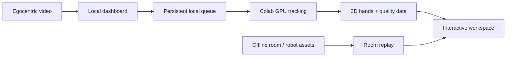

# SpectatorAI

### Egocentric hand intelligence for 3D replay, spatial understanding and robot-ready motion

> **A video is more than pixels.** SpectatorAI turns point-of-view footage into an interactive 3D record of where the wearer’s hands moved, what they saw, and how a robot could replay the task.


## The idea

Teaching a robot, reviewing a manual task, or understanding an operator’s movement usually means replaying flat video and guessing what happened in space. SpectatorAI makes that evidence spatial.

From a head-mounted, fisheye, or ordinary phone clip, it identifies the wearer’s hands, reconstructs their movement in 3D, keeps a quality record for every frame, and presents the result in a browser workspace. For imported workstation captures, it can replay detailed hand surfaces in a reconstructed room beside a synchronized source video and an optional two-arm robot retargeting.

The goal is not to replace human judgement. It is to make hand motion, context and uncertainty inspectable before that motion is used for training, review or automation.

## What you can explore

| Module | What it gives you |
|---|---|
| **Workspace** | Upload a clip, follow processing live, scrub synchronized video and 3D hands, inspect quality and export results. |
| **Library** | Reopen local workspaces and saved tracking results without reprocessing them. |
| **Dataset** | Browse output IDs, search the catalogue and play the mapped render for each ID. |
| **Room replay** | Orbit, pan and zoom a reconstructed workstation with hand meshes, head motion and a source-video overlay. |
| **Robot replay** | Open an independent robot viewport with a shared timeline, copyability grades and downloadable trajectories. |

## System overview



The dashboard stays local. It sends a tracking job to a short-lived Colab GPU only when a clip is submitted, then saves playback data on the computer. Imported room and robot results replay locally; opening them does **not** start a GPU runtime.

## Tech stack

| Layer | Technologies |
|---|---|
| Web experience | React 18, TypeScript, Vite, React Three Fiber / Three.js |
| Local application | FastAPI, Python, persistent job queue, local media streaming |
| Tracking runtime | Colab GPU, WiLoR, CLIP, GeoCalib and the multi-stage tracking pipeline |
| Spatial replay | Imported room geometry, quantized hand meshes, camera/head paths and Franka Panda retargeting assets |
| Exports | JSONL hand data, wrist/gripper CSV, quality and scene metadata, rendered video and recorded 3D views |

## Quick start

### 1. Clone and set up

```powershell
git clone <your-repository-url>
cd ps4-hand-tracking
.\setup.bat
.\run.bat
```

Open [http://127.0.0.1:8000](http://127.0.0.1:8000). `setup.bat` creates the Python environment, installs frontend dependencies and builds the dashboard. The first setup can take a few minutes.

### 2. Optional: connect a Colab GPU for new tracking jobs

```powershell
.venv\Scripts\python.exe tools\prepare_connection.py
```

Upload `CONNECT_COLAB.ipynb` to Google Colab, choose a GPU runtime, and press the single **Start SpectatorAI** cell. When asked, upload the generated private `SpectatorAI-Colab.zip`. Once the dashboard shows **Colab connected**, choose **Add video**.

The notebook requests release after inactivity. Existing Library, Dataset and Room results remain available while it is offline.

## Typical workflow

1. Start the local dashboard with `run.bat`.
2. Connect Colab only when you want to process a new clip.
3. Upload a short video from **Workspace**.
4. Follow the queue and processing status; open the result when it is ready.
5. Scrub the clip, inspect the 3D motion and quality lanes, then export data or a render.
6. Use **Room** for imported spatial/robot playback, or **Dataset** to review final mapped videos.

## Results and responsible use

Observed, infilled and estimated hand samples remain distinguishable in the data and quality lanes. Quality grades are curation aids, not calibrated accuracy claims. Robot-copyability scores are imported feasibility estimates, **not** robot-safety certification. Verify a task, workspace, hardware limits and safety controls independently before using a result on a physical system.

## Privacy-first repository layout

This repository contains source code, configuration examples, tests and notebooks—not personal footage, generated renders, room scans, model weights, API keys or local job data. `.gitignore` protects those artifacts. Keep `dashboard/.env`, `SpectatorAI-Colab.zip`, videos and `dashboard/results/` private.

```text
dashboard/frontend/     React dashboard and 3D viewers
dashboard/backend/      Local FastAPI gateway, queue and media routes
code/ps4v4/             Hand tracking, quality and export pipeline
code/ps5world/          SLAM/world-frame utilities
code/room/              Room reconstruction and web-export tooling
code/robot/             Robot retargeting and feasibility outputs
code/notebooks/         Colab and offline workflow notebooks
tools/                  Local setup, private bundle and fixture helpers
```

## More detail

- [Architecture and API reference](ARCHITECTURE.md)
- Backend API schema while running: [http://127.0.0.1:8000/docs](http://127.0.0.1:8000/docs)

## Before you publish

```powershell
npm run build --prefix dashboard/frontend
git status
git diff --check
```

Do not force-add ignored private assets.

---

Built as a spatial interface for understanding skilled human hand motion—from video, to 3D evidence, to robot-ready trajectories.
